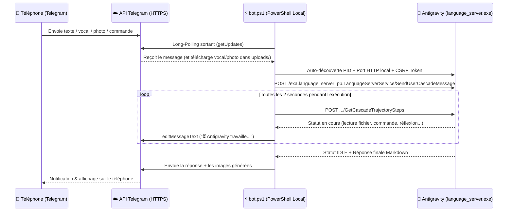

# 🤖 Antigravity Telegram Remote Control Bot

Contrôlez votre instance locale **Google Antigravity** à distance depuis votre téléphone via **Telegram**, tant que votre PC Windows est allumé — **sans ouvrir de port réseau**, **sans serveur intermédiaire**, et **sans aucune dépendance externe** (100% natif PowerShell / .NET).

---

## ✨ Fonctionnalités principales

- 💬 **Sélection & création de conversations (`/conv`, `/new`)** :
  - Affiche vos conversations Antigravity existantes avec leur titre, leur nombre d'étapes et leur statut en direct (`🟢 En cours` / `⚪ Prêt`).
  - Permet de basculer d'une conversation à une autre en 1 clic via des boutons interactifs Telegram, ou d'en créer une nouvelle.
- 🤖 **Changement de modèle IA en direct (`/modele`)** :
  - Récupère dynamiquement tous les modèles disponibles sur votre compte Antigravity et permet d'en changer à la volée :
    - **Gemini 4 Argon** (*High*, *Medium*, *Low*)
    - **Claude Opus 5.5** (*High*, *Medium*)
    - **Claude Sonnet 5.5** (*High*, *Medium*)
    - **Gemini 3.8 Flash** (*High*, *Medium*, *Low*)
- 📊 **Suivi des limites d'utilisation & fenêtre de contexte (`/limites` ou `/quota`)** :
  - Affiche une barre de progression visuelle du **quota restant** pour chaque modèle (ex. `80.2% restant`) ainsi que la date et l'heure exacte de réinitialisation (`Reset`).
  - Affiche l'utilisation actuelle de la **fenêtre de contexte** de la conversation active (`tokens utilisés / tokens max`, ex. `224k / 256k tokens`).
- 🎤 **Support natif des Messages Vocaux (`voice` / `audio`)** :
  - Envoyez un message vocal depuis Telegram : le bot télécharge le fichier `.ogg` localement et demande à Antigravity de l'écouter directement via son outil multimodal natif `read_file`, de résumer ce qu'il a compris et d'exécuter vos instructions vocales.
- 🖼️ **Transfert bidirectionnel d'Images & Fichiers (Téléphone ⇄ PC)** :
  - **Téléphone ➔ PC** : Envoyez une ou plusieurs photos, documents PDF ou archives sur Telegram (avec ou sans légende) pour qu'Antigravity les inspecte, les recadre ou les intègre à votre projet.
  - **PC ➔ Téléphone** : Toutes les images locales mentionnées dans la réponse d'Antigravity vous sont envoyées automatiquement en photo sur Telegram. Vous pouvez aussi télécharger n'importe quel fichier du PC avec `/file <chemin>`.
- 📸 **Capture d'écran du PC en direct (`/screen`)** :
  - Prend une capture d'écran haute définition de votre écran Windows et vous l'envoie instantanément sur Telegram.
- ⏳ **Suivi d'exécution en temps réel & Bouton Stop (`/stop`)** :
  - Affiche en direct ce que fait l'agent (`🔧 Exécution d'une commande...`, `📎 Lecture de fichier...`, `✨ Modification du code...`) avec le temps écoulé et un bouton `🛑 Arrêter` (`CancelCascadeInvocation`).
- ⚡ **Mode Anti-Veille Windows intégré** :
  - Appelle l'API Win32 `SetThreadExecutionState(ES_CONTINUOUS | ES_SYSTEM_REQUIRED)` pour empêcher Windows de se mettre en veille tant que le bot tourne.
- 🔒 **Sécurité par verrouillage automatique (`authorizedChatId`)** :
  - Dès le premier message envoyé au bot, celui-ci enregistre votre `chat_id` Telegram personnel dans `config.json` et bloque toute tentative d'accès provenant d'un autre compte Telegram.

---

## 🛠️ Comment ça marche sous le capot ? (Architecture)



### 1. Découverte automatique du serveur local Antigravity (`language_server.exe`)
Lorsque l'application **Antigravity** est ouverte sur Windows, elle fait tourner en arrière-plan un serveur local nommé `language_server.exe` qui écoute uniquement sur `127.0.0.1` sur un port dynamique et exige un jeton de sécurité `--csrf_token`.

Le script `bot.ps1` :
1. Inspecte les processus Windows actifs (`Get-CimInstance Win32_Process -Filter "Name = 'language_server.exe'"`) pour extraire dynamiquement le `--csrf_token` passé en ligne de commande.
2. Inspecte les ports TCP ouverts par ce PID (`Get-NetTCPConnection -OwningProcess <PID> -State Listen`) sur `127.0.0.1`.
3. Interroge le serveur local via le protocole **ConnectRPC** (`Connect-Protocol-Version: 1` et en-tête `x-codeium-csrf-token`). Si Antigravity est redémarré, le bot redécouvre automatiquement le nouveau port et le nouveau jeton.

### 2. Appels RPC locaux utilisés par le Bot
Le bot communique directement avec `http://127.0.0.1:<port>/exa.language_server_pb.LanguageServerService/<Method>` :
- **`GetUserStatus`** : Récupère le profil utilisateur, le forfait, la liste des modèles (`clientModelConfigs`), le pourcentage de quota restant (`remainingFraction`) et l'heure de remise à zéro (`resetTime`).
- **`GetAllCascadeTrajectories`** : Liste toutes les conversations existantes (`cascadeId`, titre `summary`, nombre d'étapes `stepCount`, statut `CASCADE_RUN_STATUS_RUNNING` ou `CASCADE_RUN_STATUS_IDLE`).
- **`GetCascadeTrajectorySteps`** : Lit les étapes d'une conversation en temps réel pour afficher l'outil en cours d'exécution et récupérer la réponse finale (`CORTEX_STEP_TYPE_PLANNER_RESPONSE`).
- **`GetCascadeTrajectoryGeneratorMetadata`** : Lit les métadonnées du modèle pour afficher les tokens utilisés dans la fenêtre de contexte (`estimatedTokensUsed / maxContextTokens`).
- **`StartCascade`** : Crée une nouvelle conversation avec le modèle et le dossier de travail souhaités.
- **`SendUserCascadeMessage`** : Envoie un message utilisateur avec le modèle sélectionné (`plannerConfig.planModel`) et active la politique d'exécution automatique des commandes (`CASCADE_COMMANDS_AUTO_EXECUTION_EAGER`) pour qu'aucune boîte de dialogue ne bloque l'agent à distance.
- **`CancelCascadeInvocation`** : Interrompt immédiatement une génération en cours (`/stop`).

---

## 🚀 Installation & Démarrage rapide (pour tout le monde)

### Prérequis
- Un PC sous **Windows 10 ou Windows 11** (PowerShell 5.1 est déjà préinstallé nativement sur tous les Windows).
- L'application **Antigravity** installée et ouverte sur votre PC.
- L'application **Telegram** sur votre téléphone.

### Étape 1 : Créer votre Bot sur Telegram (30 secondes)
1. Ouvrez Telegram et cherchez **[@BotFather](https://t.me/BotFather)**.
2. Envoyez-lui la commande `/newbot`.
3. Choisissez un nom d'affichage (ex. `Mon Antigravity PC`) puis un nom d'utilisateur se terminant par `bot` (ex. `mon_antigravity_123_bot`).
4. **BotFather** vous renvoie un **Token HTTP API** (sous la forme `1234567890:AAH...`). Copiez-le.

### Étape 2 : Télécharger et lancer le Bot sur votre PC
1. Clonez ce dépôt (ou téléchargez le ZIP depuis GitHub et extrayez-le) :
   ```powershell
   git clone https://github.com/justr4mzi/antigravitytelegrambot.git
   cd antigravitytelegrambot
   ```
2. Double-cliquez sur **`Lancer_Bot_Telegram.bat`** (ou lancez `powershell -ExecutionPolicy Bypass -File .\bot.ps1`).
3. Au premier lancement, collez votre **Token Telegram** dans la console lorsque le script vous le demande.
4. Sur votre téléphone, ouvrez votre nouveau bot dans Telegram et appuyez sur **Démarrer** (`/start`) :
   - Le bot verrouille automatiquement l'accès sur votre compte Telegram (`authorizedChatId` sauvegardé dans `config.json`).
   - Le menu de contrôle et les boutons rapides apparaissent en bas de votre écran !

---

## 📱 Commandes & Boutons disponibles dans Telegram

| Commande / Bouton | Action |
| :--- | :--- |
| `/start` ou `/menu` | Affiche le tableau de bord complet (conversation active, modèle actif, quota restant) |
| `💬 Conversations` (`/conv`) | Affiche les 10 dernières conversations pour changer de conversation en 1 clic |
| `🤖 Modele` (`/modele`) | Affiche tous les modèles IA disponibles avec leur `%` de quota pour changer de modèle |
| `📊 Limites` (`/limites` ou `/quota`) | Affiche les barres de quota de chaque modèle, l'heure de reset et les tokens de contexte |
| `🆕 Nouvelle conv` (`/new [message]`) | Crée une nouvelle conversation dans Antigravity et bascule dessus |
| `📸 Ecran PC` (`/screen`) | Prend une capture d'écran en direct du PC et l'envoie en photo sur Telegram |
| `🛑 Stop` (`/stop`) | Arrête immédiatement l'exécution en cours dans la conversation active |
| `/last` | Renvoie la dernière réponse complète de l'assistant |
| `/file C:\chemin\fichier.ext` | Télécharge n'importe quel fichier de votre PC directement dans la discussion Telegram |
| **Message vocal 🎤** | Téléchargé et écouté directement par Antigravity qui exécute vos instructions vocales |
| **Photo 🖼️ / Document 📎** | Transféré dans le dossier `uploads/` du PC et envoyé à Antigravity pour traitement |

---

## 📁 Structure du dépôt

- `bot.ps1` : Script principal du bot (connexion ConnectRPC locale, Long-Polling Telegram, Watcher temps réel, capture d'écran, anti-veille).
- `Lancer_Bot_Telegram.bat` : Lanceur Windows en 1 clic.
- `default_cascade_config.json` : Modèle de configuration `CascadeConfig` permettant l'exécution autonome à distance (`CASCADE_COMMANDS_AUTO_EXECUTION_EAGER`) et le choix dynamique du modèle (`planModel`).
- `config.example.json` : Exemple de fichier de configuration (le vrai fichier `config.json` contenant votre token est ignoré par `.gitignore`).

---

## 📄 Licence
Distribué sous licence **MIT**. Créé par [@justr4mzi](https://github.com/justr4mzi).
